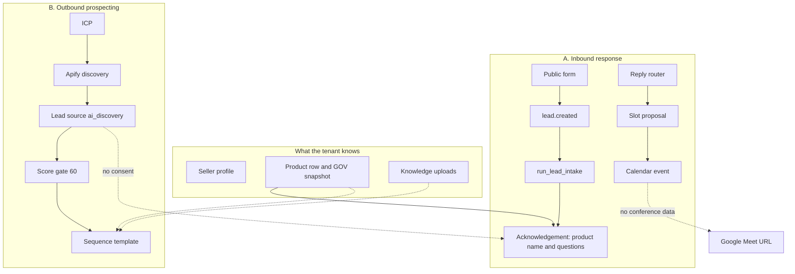
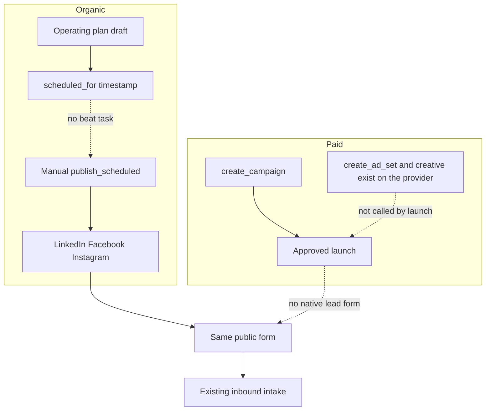
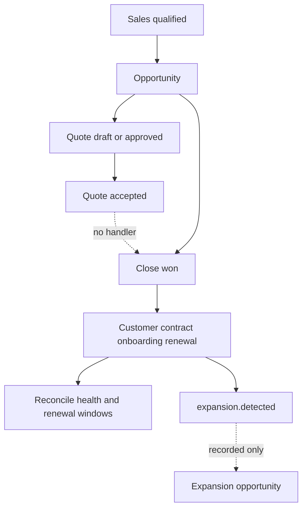

# Current capability audit

## Current status — 2026-10-27, discovery follow-through

This is the current status. The outbound section below, the executive assessment, the baseline table, the capability matrix, and the organic addendum are earlier the same day. Where they disagree with this section, this section is the one to use.

Discovery now continues through the existing outbox. The run stores the tenant, the chosen ICP, the chosen operating plan, and the filters passed to the provider. It does not pick the newest plan. The lead keeps that plan and ICP. Identity deduplication stays on email, LinkedIn URL, and provider reference. Two people with the same name are not merged. Empty email, phone, and firmographics stay empty. Mock or unconfigured account research is stored as incomplete. It does not invent a brief or turn an inference into a verified fact.

A saved person is assessed after the row exists. Product fit, evidence coverage, and channel permission stay separate. Discovery does not send an acknowledgement. A public address and an automation grant do not create consent. Of the 28 discovery leads in this database, none have email consent on the lead or the linked contact, and there is no consent audit action. They are not treated as permitted. A lead without outbound permission stays, with a task that says channel permission is missing, and with no send approval. A permissioned, assessment-eligible fixture enrolls the sequence bound to that plan and prepares one draft. Sending stays behind approval. A later research note does not replace that draft. A numerical score does not override the assessment. Missing fit stays a gap. Opt-out and a verified not-a-fit stay stops.

The lead dossier shows source, selected product, missing fields, enrichment state, eligibility, owner, next action, and the draft approval id. The approval card shows the product, the facts, the gaps, the generation label, and the context version. The command centre still lists discovery runs. No new dashboard was added.

### Running locally

| Item | Value |
|---|---|
| Database | Alembic `038`, applied after a backup at `036` |
| Backup | `.local-backups/agrayian-before-037-2026-10-27.dump`, custom format, gitignored. Counts at backup: 9 enrollments, 18 approvals, 43 leads, 901 decisions |
| Code checkpoint | Uncommitted working tree on `35874c9aeb5ef0f54e73b235344b394d3f847f79`. That commit alone is not this schema |
| Restore | Stop api, worker, and beat. `pg_restore --clean --if-exists` the dump into `agrayian` inside the Postgres container. The restored schema is `036`. Upgrade before starting the current images |
| Disposable proof | A restored copy was upgraded `036` → `038`. Existing enrollments kept blank context. Existing decisions stayed `outbound_eligible` false. Existing leads kept a null ICP. The copy was dropped |
| Scope | One row, `prepared`, expiry `2026-10-29 18:03:28.181796+00`. Not authorized |
| Holds | 3 approvals and 9 enrollments remained `held` |
| Images | api, web, worker, and beat rebuilt and running. Worker and beat were stopped during the upgrade |
| Browser | An isolated approval and lead were opened, then deleted. Real approvals were not decided. No research, publish, or send button was used |

Before the workers restarted, the prepared scope blocked billable discovery, live publish, send, and ads. After restart, due publish, the outbox, and the stale-hold pass had nothing to release. The existing mailbox poll read Gmail history and stored nothing new. No discovery run, publish, send, booking, call, or spend was started for this milestone.

### What this section supersedes

| Capability | Current state |
|---|---|
| Discovery to outreach | Fixture-verified in `tests/test_discovery_follow.py`. The local lead page shows the bound product and the missing permission. A real Apify run was not made |
| Enrichment | The discovery path refuses simulated firmographics. Missing fields stay listed. A live enrichment vendor was not called |
| First outbound sales email | Unchanged from the outbound section, and now reachable from an explicitly bound discovery plan in fixtures. Sending stays blocked |
| Account research brief | Eligible stored research is still read by the draft. The discovery path does not invent one when the model is mock or unconfigured |

## Current status — 2026-10-27, product-aware outbound drafts

This section is the outbound milestone from earlier on 2026-10-27. The discovery section above supersedes it where they disagree. The executive assessment, the baseline table, and the capability matrix below are the morning audit. The organic-acquisition addendum later in this file is the same day's earlier milestone. Those sections stay as dated history.

Outbound sequence drafts now use the shared product context. The product comes from the sequence's operating plan, the lead's operating plan, or one campaign plan named by the sequence offer. Those links must agree. If none is set, the draft names no catalogue product and the next action is `choose_operating_plan`. If they disagree, enrollment returns a configuration error and no approval is stored. The chosen context is frozen on the enrollment and copied onto the approval. A later catalogue or snapshot edit does not change that approval or the next step of the same enrollment. GOV is the fixture used to prove this. It is not a hardcoded product rule.

Every email step goes through `draft_email_from_facts`. The model receives the step purpose, the frozen product context, the lead's name, role, company, and enquiry, account facts, stored conversation snippets, and eligible research. A first step is not titled "Follow-up". A later step is "Next step on {product}" unless a real inbound message supplies a subject. The price stays in the context. It is written into the email only when the step or the enquiry asks about price. The deterministic fallback, used when the model fails, is mocked, or returns an unusable body, is labeled and uses only the frozen context and known lead facts. It does not keep unresolved placeholders or copy an unsupported discount or testimonial out of the template.

Research is included only when it is the same tenant, it is for that lead or that lead's account, it is no older than 30 days, and it has a brief plus a source. Customer-supplied facts, sourced observations, and inferences are stored separately. An inference is labeled as not a verified customer problem. Retrieved text is data. Tests do not call Apify, scrape, or a live model.

Outbound eligibility is an assessment decision. Consent, a resolved identity, a prospect identified by company or a known firmographic facet, and the absence of an inbound enquiry are required. A numerical score is recorded and does not veto that decision. Consent alone does not make a lead eligible. Channel permission, suppression, opt-out, wrong-person stop, pause, approval, grant, and the separation between acknowledgement and sequence are unchanged.

The existing approval card shows the customer-facing product, subject, body, personalisation, source references, missing information, generation or fallback, eligibility, and next action. The sequence page shows whether an operating plan is selected. No new dashboard was added.

A DEMO tenant cannot call the LinkedIn or Meta publisher for `social.publish` unless an applicable authorized scope allows that version and channel. A missing, prepared, expired, or wrong-action scope makes no live call. An explicitly configured mock publisher still publishes. PILOT and PRODUCTION without a scope are unchanged. The prepared demonstration was not authorized and its expiry was not changed.

### Matrix rows this section supersedes

| Capability | Current state |
|---|---|
| Offer snapshot | Frozen onto the sequence enrollment at draft time, and stored on the approval. A later catalogue edit does not rewrite an approved draft. |
| Account research brief | Eligible stored research is included in the sequence draft. Stale, cross-tenant, unrelated, or sourceless research is excluded. The draft does not launch research. |
| Inbound acknowledgement | Still the separate path. It uses the frozen creative context and includes the price only when the enquiry asks. |
| First outbound sales email | Fixture-verified in `tests/test_outbound_sequence.py`. Product-bound, evidence-labeled, and reviewable on the approval. Sending stays behind approval, grant, and the demonstration block. |
| Organic LinkedIn, Facebook, and Instagram | The due scheduler remains. A real publisher on a DEMO tenant now also requires an authorized `social.publish` scope when no scope is open. Historical posts are not this check. |
| LinkedIn ads | A zero, missing, invalid, or exhausted spend limit still refuses activation. Campaign children are not built. |

### Still true

No live email was sent, no live post was published, no meeting was booked, no call was placed, no ad spend was made, and no discovery run was started for the outbound milestone. The copilot email generator was not changed. Knowledge-base retrieval is still not the research input for a sequence. Benefits are taken from a stored list and are not invented from a description. Alembic `037` was applied later the same day, together with `038`, as recorded in the discovery section above.

## Executive assessment

Morning baseline, 2026-10-27, before the organic and outbound milestones. Read-only. No messages were sent, no posts were published, no calls were placed, no meetings were booked, no ads were activated, no migrations were applied, and no grants or settings were changed. The existing pytest suite was not re-run. Classifications below come from the working tree, the running local database, and named tests already in the repository.

The repository contains a multi-tenant revenue operating system with real modules for CRM, assessment, inbound mail, sequences, approvals, discovery, organic posting, ad campaign shells, calendar booking, close-won activation, and post-sale reconciliation. Those modules are mostly proven with provider fakes. They are not one autonomous loop.

The running local application is a **prepared demonstration**, not an authorized pilot. Both tenants are in operating mode `DEMO`. One operating plan is `running` on SKU `GOV` and has a frozen product snapshot. The demonstration scope is `prepared`, unbound, and blocks every external action until someone authorizes it. Autopilot is enabled, and email, voice, and ad-spend approvals are required.

What a person can complete today, with evidence in this database or in the implementation log, is narrower:

- Gmail is connected and has already stored inbound mail and two outbound messages from 2026-10-10. A later check recorded mailbox identity, inbox reading, and calendar free/busy without sending or creating an event.
- LinkedIn, Facebook, and Instagram have historical non-mock published posts in this database. Three Instagram form submissions became consented CRM leads. A later LinkedIn organization permission read was recorded as HTTP 403.
- Apify discovery has stored people. Most of those rows have a LinkedIn URL and no email consent.
- No voice session, no Google Calendar meeting, no launched ad, and no accepted quote is stored.

The product catalogue and the operating-plan snapshot know the selected offer. The inbound acknowledgement uses the product **name** only. The outbound sequence email is a rewrite of a step template and does not receive the lead, the product, the price, or retrieved knowledge. Gemini is configured and is not the cause of that gap. A model failure on the sequence path returns the template unchanged.

Public hosting is still postponed. The API's public base is loopback HTTP. MinIO is configured and is not running. Live callbacks and publicly fetchable ad images can wait. The internal journeys below can be completed against fakes first.

## Baseline

| Item | Established value |
|---|---|
| Commit | `35874c9aeb5ef0f54e73b235344b394d3f847f79` on `main` (2026-10-23, "Hold stale outreach and keep one selected offer for a controlled demonstration.") |
| Working tree | Uncommitted demonstration binding. Modified: `CURRENT_PHASE.md`, `IMPLEMENTATION_LOG.md`, `apps/api/app/models/operating_plan.py`, `apps/api/app/services/acknowledgement.py`, `apps/api/app/services/demo_guard.py`, `apps/api/app/services/grants.py`, `apps/api/app/services/marketing.py`, `apps/api/tests/test_demo_readiness.py`, `apps/api/tests/test_migration_034.py`. Untracked: `apps/api/alembic/versions/035_demo_binding.py`. Diff stat at audit time: 9 files, +500 / −26, plus the new migration. |
| Database | Alembic `035`, read from `alembic_version`. `demo_scopes.binding_digest` and `allowed_actions` exist. |
| API | `salesengine-api` image created 2026-10-26 18:03 UTC. `GET /health` and `GET /ready` on port 8002 return version `0.1.0`, environment `development`, app name AGRAYIAN Autonomous Revenue OS. The running process imports `DemoScope.binding_digest`. |
| Worker and beat | Same image creation time. Both containers report healthy. Beat already runs the schedules in `apps/api/app/workers/celery_app.py`. This audit did not add a cycle. |
| Web | `salesengine-web` created 2026-10-26 16:26 UTC. `GET /` on port 3000 returns 200. No web files are in the uncommitted diff. |
| Deployment decision | Local only. `public_api_base_url` is HTTP on loopback. |
| Object storage | `OBJECT_STORAGE_PROVIDER=minio` inside the API. The MinIO service is defined in `docker-compose.yml` and is not running. |
| Tenants | Two tenants, both `operating_mode=DEMO`. |
| Demonstration | One `demo_scopes` row, status `prepared`, `binding_digest` empty. Allowed action caps: `email.acknowledge` 1, `email.send` 1, `calendar.book` 1. |
| Operating plan | One plan, status `running`, product SKU `GOV`, context snapshot present. |
| Provider modes in the running API | LLM `gemini` with a model id set. Email `gmail`. Calendar `google`. Discovery `apify`. Channel search `apify`. LinkedIn posting `live`. LinkedIn ads `live`. Meta posting `live`. Meta ads `sandbox`. Voice telephony `mock`. Voice conversation `mock`. WhatsApp unset. |
| Credential presence | Set, values not recorded: Gemini key, Apify token, LinkedIn access and post tokens, LinkedIn organization id, Meta access token, Meta page token, Meta page id, Instagram business id, Dograh embed token. Empty: Dograh API key, Dograh agent UUID, WhatsApp token. |
| Connected account rows | `google` status `connected`, with success and a prior failure timestamp, current error empty. Scopes include `gmail.readonly`, `gmail.send`, `calendar.readonly`, `calendar.events`. `dograh` status `connected`, with a success timestamp. No LinkedIn or Meta row in `provider_accounts`; those modes come from environment settings. |
| Autopilot | Both tenants: enabled, emergency stop off, discovery on, sequence enrollment on, email/voice/ad approvals required, health/renewal/expansion on, proposal preparation off, minimum lead score 60, daily and monthly ad budget limits `0`. In `budget_block_reason`, a limit of `0` does not cap spend. |
| Tests | Not executed in this audit. Named test modules are evidence of fixture coverage only. |

Stored local counts, without identities or message bodies:

| Record | Count |
|---|---|
| Products | `CORE` subscription INR 50,000; `GOV` one-time INR 300,000; `CS` one-time INR 400,000 |
| Knowledge sources | 3 uploads, status `ready`, malware status `NOT_CONFIGURED` |
| Leads | 34 `ai_discovery`, 4 `inbound`, 3 `social_post` / Instagram, 1 `public_form`, 1 `operator` |
| Discovery shape | 28 with LinkedIn URL, no email, `consent_email` false. 6 with email, no LinkedIn URL, `consent_email` true, channel `discovery`. The origin of those six consent flags was not reconstructed. |
| Email messages | 5 inbound Gmail on 2026-10-10, 2 outbound Gmail on 2026-10-10, 1 inbound Gmail on 2026-10-23. Stored status is `SENT` for all eight. Bodies were not read. |
| Social posts | Non-mock, with provider id and permalink: LinkedIn 3 published, Facebook 1 published, Instagram 3 published. LinkedIn 1 draft. Permalinks were not opened. |
| Campaigns | No provider external id. LinkedIn drafts 2, plus internal `abm`, `inbound`, and `outbound` rows. |
| Creative versions | 3 drafts |
| Meetings | 2 `booked` and 1 `logged`, all provider `human`. None are Google Calendar. |
| Quotes | 1 draft |
| Opportunities | discovery 3, qualification 1, demo 1, proposal 1, negotiation 1, closed_won 1 |
| Customers | 1 `live`, 1 `at_risk`. This audit did not reconstruct whether they came from seed data. |
| Voice sessions | 0 |
| Conversations | 5 `replied`, 1 `open`, 1 `closed` |

`IMPLEMENTATION_LOG.md` for 2026-10-26 records a Gmail identity, inbox read, and calendar free/busy success, no send, and no calendar create. It also records HTTP 403 for the LinkedIn organization and publishing-permission reads. This audit did not repeat those calls. A stored token is not treated as a current permission.

One operating fact needs an owner decision and was not changed: automatic discovery is skipped while a prepared or authorized demonstration scope is open (`autonomy.run_autonomous_cycle`). The second DEMO tenant has Autopilot and discovery enabled and does not have that scope. The already-running beat can call Apify for that tenant on its 15-minute cycle.

## How to read the matrix

| Label | Meaning in this audit |
|---|---|
| UI only | A screen or control has no completing backend path. |
| Disconnected | Backend code exists and is not on the user workflow that appears to own it. |
| Fixture-verified | An automated test drives the path with fakes or an in-memory provider. The suite was not re-run here. |
| Real operation | This database or the 2026-10-26 log records one specific provider result. It does not prove the whole capability. |
| Blocked | The path exists and the current mode, permission, demo scope, or missing process stops it. |
| Missing | No implementation that performs the step. |

## Capability matrix

Morning baseline, 2026-10-27. The rows named in "Current status" at the top of this file supersede this matrix.

| Capability | UI | Backend | Automation | Provider evidence | Blocker | Source |
|---|---|---|---|---|---|---|
| Company profile | Settings and Content | `content.save_profile`, `SellerProfile` | Manual save | Fixture tests around content | None for local save | `apps/api/app/api/v1/content.py`, `apps/web/src/app/(app)/settings/company/page.tsx` |
| Product catalogue | Content | `Product` with SKU, kind, list price, currency, description | Selected by the operating plan | Local rows above | No features, benefits, use cases, audiences, or exclusions as fields | `apps/api/app/models/lifecycle.py` `Product` |
| Offer snapshot | Operating plan | `marketing._freeze_context`, `context_snapshot` | Frozen at plan start | Local plan is `GOV` and has a snapshot | Snapshot is not the sequence-email input | `apps/api/app/services/marketing.py` |
| Knowledge upload and search | Knowledge | `rag.ingest_text`, `retrieve` | Manual upload | 3 local sources; malware scan `NOT_CONFIGURED` | Not retrieved for sequence mail or acknowledgements | `apps/api/app/ai/rag.py`, `apps/api/app/api/v1/ai.py` |
| Approved claims and case studies | Profile proof field | Free text only | None | None | Missing as a registry | `SellerProfile.proof` |
| Website fact research | Site signals | `site_signals` reads a public page and sitemap | Manual run | Fixture tests in `test_site_signals.py` | Does not create leads, enroll, or send | `apps/api/app/services/site_signals.py` |
| Account research brief | Copilot / intake | `research_account` stores an `AIRecommendation` | Intake when enabled and an account exists | Fixture path | Brief is not inserted into the email | `apps/api/app/ai/runtime.py`, `orchestrator.run_lead_intake` |
| Inbound acknowledgement | Approvals | `acknowledgement.prepare_acknowledgement` | `lead.created` to intake | Fixture: `test_inbound_journey.py`, `test_assessment_journey.py`, `test_demo_readiness.py` | Prepared demo blocks the send. Body is the product name plus up to four questions | `apps/api/app/services/acknowledgement.py` |
| First outbound sales email | Sequences, Approvals | `lifecycle.enroll_sequence` calls `draft_email_from_facts` | Due steps every 15 minutes | Fixture: `test_autopilot_control_plane.py` | Template only. Score gate 60. Prepared demo blocks `sequence.email.send` | `apps/api/app/services/lifecycle.py`, `content.draft_email_from_facts` |
| Manual copilot draft | Copilot | `runtime.draft_email` | Approval if send is requested | Fixture | Lead JSON and prompt registry. RAG is on the copilot chat path | `apps/api/app/api/v1/ai.py` |
| Gmail send and read | Integrations | `execute_email_send`, `inbox.sync_all_tenants` | Poll every 60 seconds | Real: connected account; 2 historical outbound and 6 inbound Gmail rows; log of identity and read on 2026-10-26 | Prepared demo blocks a new send. Polling is the inbound design | `apps/api/app/providers/email.py`, `apps/api/app/services/inbox.py` |
| Reply classification | Conversations | `reply_intelligence.classify_reply`, `reply_router.route_reply` | Outbox within about 60 seconds | Fixture: `test_inbound_journey.py`, `test_live_engagement.py` | OOO and nurture resume labels have no worker | `apps/api/app/services/reply_router.py` |
| ICP and Apify discovery | ICP, Leads | `build_discovery_query`, `ApifyLeadDiscoveryProvider`, `persist_discovered_lead` | 15-minute cycle, skipped while a demo scope is open | Fixture HTTP mocks in `test_discovery.py`. Local stored people are past results. This audit did not call Apify | Second tenant can still be cycled by the running beat. No email is not consent | `apps/api/app/services/discovery.py`, `discovery_query.py` |
| Public interest form | `/capture/[token]`, Acquisition | `public.capture` to `capture_inbound` or `hold_interest` | `lead.created` via outbox | Fixture tests. Local: 1 `public_form` lead and 3 Instagram `social_post` leads with `consent_email` | A submission needs name, email, request note, and email consent, otherwise it is held for review | `apps/api/app/api/v1/public.py`, `apps/api/app/services/acquisition.py` |
| CSV import | Imports | `commit_import` | Scores the lead and does not emit `lead.created` | Code inspection | Disconnected from intake | `apps/api/app/api/v1/imports.py` |
| Social messages and native lead forms | None | None | None | None | Missing. A person would copy them by hand | No webhook or inbox handler creates a lead from a comment, DM, or LinkedIn/Meta lead form |
| Channel search | Channel search | `channel_search` via Apify Google results | Background task only when enabled; running flag is false | Fixture: `test_channel_search.py`. Mode is Apify | Results are not posts and are not leads | `apps/api/app/services/channel_search.py` |
| Organic LinkedIn | Social, wizard | `LinkedInSocialPublisher.publish` | Approval or direct publish. No schedule worker | Real historical posts in this database. Log: organization permission read 403 on 2026-10-26 | Current permission unverified. Publisher discards `image_url` | `apps/api/app/providers/social.py` `LinkedInSocialPublisher` |
| Organic Facebook | Social | `MetaSocialPublisher` page feed or photo | Same | One real historical post in this database | Current token not re-checked | `apps/api/app/providers/social.py` |
| Organic Instagram | Social | Image required; caption includes the form link | Same | Three real historical posts and three consented leads | Image must be fetchable by Meta. MinIO is down and the public base is loopback | `instagram_can_fetch` |
| YouTube, X, WhatsApp posting | Wizard offers YouTube | Status only, or `PreparedAdsProvider` for ads | None | None | Missing publisher | `apps/web/src/components/post-wizard.tsx`, `social.py` `CHANNELS` |
| Organic metrics and optimization | Operating plan metrics | `record_metrics` | Manual numbers. `proposal_only` after 100 impressions. No budget change | No organic insights pull | Missing provider read | `marketing.record_metrics` |
| Meta ads | Campaigns | `MetaAdsProvider` campaign create, and separate creative methods | Launch approval, then `execute_ads_spend` | Sandbox mode. No Meta campaign row. Sandbox activation returns without a spend call | Sandbox, prepared demo, and approval | `apps/api/app/services/ads.py` `execute_ads_spend` |
| LinkedIn ads | Campaigns | `LinkedInAdsProvider.create_campaign` creates a paused campaign | Same launch path can then activate | Mode is `live`. Local campaigns have no external id. No spend figure is stored | Prepared demo blocks `ads.launch`. Budget limits are 0, so they are not a cap | `apps/api/app/providers/ads.py` |
| Google ads | None beyond a channel name | `PreparedAdsProvider` | None | None | Missing | `get_ads_provider` |
| Calendar free/busy and event create | Meetings, booking API | `GoogleCalendarProvider` | Approval or discovery-booking confirm | Log: free/busy succeeded on 2026-10-26. Code posts `events` without conference data. Local meetings are `human` | Prepared demo blocks `calendar.book` | `apps/api/app/providers/calendar.py` `create_event` |
| Google Meet | None | No `conferenceData` and no stored join URL | None | None | Missing | `GoogleCalendarProvider.create_event` |
| Meeting record and summary | Meetings | Recall, upload STT, or manual transcript. Insights must cite or abstain | Consent required before a bot join | Fixture: `test_meeting_intelligence.py` | Separate from booking. Join URL is typed by a person | `apps/api/app/services/meeting_capture.py` |
| Voice dial, Twilio / Exotel / Vapi | Conversations | `queue_voice_dial`, `execute_voice_dial`, webhooks | Approval, then provider action | Fixture: `test_voice.py`, `test_india_voice.py` | Running voice mode is `mock`. No public callback host | `apps/api/app/services/voice.py`, `inbox.py` providers `twilio`, `vapi`, `exotel` |
| Dograh outbound call | Test panel is separate | `DograhConversationProvider.attach` | Same approval path when conversation mode is Dograh | Tenant row is `connected`. Env API key and agent UUID are empty. Voice sessions: 0 | Completion webhook is not implemented. Widget context is page URL and today's date | `apps/api/app/providers/voice_conversation.py`, `apps/api/app/services/dograh_browser.py` |
| Quote acceptance | Commercial | `workflow.accept_quote` sets `accepted` | None | Local quote is still `draft` | Does not win the deal or create a customer | `apps/api/app/api/v1/workflow.py` `accept_quote` |
| Close won, onboard, renew | Opportunity | `crm.close_won` calls `activate_customer` and `ensure_renewal` | Post-sale beats | Fixture: `test_post_sale.py`. Local: one `closed_won` and two customers; origin not reconstructed | Proposal preparation is off, so the quote is a human task | `apps/api/app/services/crm.py`, `post_sale.py` |
| Expansion event | Expansion page | `handle_post_sale_event` returns `expansion_recorded` | Detection also exists on the reconcile beat | Code | The event handler does not open an opportunity | `post_sale.handle_post_sale_event` |
| SEO publishing and Search Console | None | Sitemap is read from other companies' sites for sales facts | None | None | Missing | `site_signal_catalog.py` |
| Command Centre | Home, operations | `operations.py` boards and event counts | Outbox and reconcile | Code and local plan/demo rows | Several labels describe work the beat does not finish | `apps/api/app/services/operations.py` |

## Workflow diagrams

These diagrams show the connections that exist in code. A dashed edge is a gap.

## Product knowledge and personalisation

### How the engine learns

Learning is manual unless a person runs a job.

1. Company profile is saved through `PUT /api/v1/content/profile` into `seller_profiles`.
2. Products are saved through `POST /api/v1/content/products`. The columns are SKU, name, kind, list price, currency, and one description. There is no structured feature, benefit, use case, audience, exclusion, approved claim, or case study.
3. `POST /api/v1/operating-plans/start` freezes `_snapshot_payload`: product id, SKU, name, kind, list price, currency, description, audience, and seller summary. The local running plan is `GOV` and the snapshot is present. `CORE` and `CS` remain stored and are not the selected offer.
4. Knowledge files are uploaded through `POST /api/v1/ai/knowledge` and chunked for retrieval. Three local uploads are ready. Malware scanning is `NOT_CONFIGURED`. Retrieval is tenant-scoped. Nothing in the upload path marks a chunk stale when the product price changes. The snapshot is a separate frozen copy, so a later catalogue edit does not silently change an open plan that already has a description and a name (`_freeze_context` returns the current snapshot in that case).
5. Website signals confirm a catalog of public facts and can read another company's site. They do not ingest the tenant's own site into the product catalogue, and they do not email anyone.
6. Account research during intake stores a brief on the account. It is not retrieved when an email is written.
7. Conflicting facts have no merge policy. The acknowledgement prefers the latest plan's snapshot name, then that plan's product, then the oldest product, then the tenant name. The sequence email never consults those sources, so it cannot conflict with them. Marketing generation is instructed to use only the facts in the prompt and to avoid invented prices, discounts, and testimonials. There is no citation record tying a sentence to a source.

### What reaches each channel

| Channel | What is actually supplied |
|---|---|
| Inbound acknowledgement | Product name from the snapshot. Optional questions for industry, employees, role, and business need. The price, description, and lead's words are not in `_body`. |
| Sequence email | `SequenceStep.template` only, sent to `draft_email_from_facts`. |
| Copilot email draft | Lead or related record JSON, plus the `email_draft` prompt. |
| Social and content drafts | Seller profile, selected product description and list price, prior sent drafts, and an optional operator note. |
| Operating-plan creative | The frozen snapshot, written into deterministic copy. Gemini is not required for that template. |
| Voice | The published voice-script body, capped for Dograh. The lead and the product are not added. The browser widget sends page URL and the date. |

### One outbound first-touch path

Entry: a consented lead that is not response-eligible, usually `POST /api/v1/leads` or discovery persist, emitting `lead.created`.

Next step: `process_outbox` or the discovery route's immediate `process_pending_events` calls `orchestrator.handle_event`, then `run_lead_intake`.

Inside intake, in order: optional enrichment, score, `qualify_lead` / `assess_and_store`, optional `research_account`, a text next-best-action, then `prepare_outreach`.

`prepare_outreach` sends an acknowledgement when the latest assessment is `response_eligible` and the source is not `ai_discovery`. Otherwise it requires `sequence_enrollment_enabled`, `outreach_preparation_enabled`, consent, no opt-out, and `total >= minimum_lead_score` (60 on both local tenants). It then calls `journey_engine.select_activated_sequence` and `lifecycle.enroll_sequence`.

`enroll_sequence` stores an `AIApproval` of type `sequence.email.send`. The body is `draft_email_from_facts(db, tenant_id, first.template)`. The subject is the literal `Follow-up`. The stored `why` and `evidence` are fixed sentences about consent and the score. They are not chunk ids or research citations.

`draft_email_from_facts` asks the configured model to write one plain-text body from the template and to add no price, customer, or claim that is not already in that text. On HTTP or runtime failure, on a mock provider, or on `NOT_CONFIGURED`, it returns the template unchanged. The local API is configured for Gemini. A Gemini failure therefore still produces the template, not a researched letter. The model does not see the lead's name, company, title, notes, the `GOV` price, the snapshot description, or the knowledge base.

The email is template-personalised only when an operator has already written the personal facts into the step template. It is not research-based. The correct product and price tier are selected only if that same template happens to name them. `select_activated_sequence` can filter on ICP industry, campaign, and `offer_key`. It does not load `products.id` or the operating plan.

Human approval is the delivery gate unless `send_authorization` returns `execute`. The local demonstration is `prepared`, so `external_execution_block` returns the prepared-demonstration message for external actions, including this send. A later authorized scope that lists allowed actions also refuses `sequence.*`.

### Inbound acknowledgement, kept separate

`prepare_acknowledgement` is the response to a consented enquiry. It is idempotent per lead and content version. The body is deterministic, not a model draft. The local product name resolves from the `GOV` snapshot. The list price in that snapshot is not rendered. Missing assessment facets become the four fixed questions. A grant can auto-send `email.acknowledge` when the scope is authorized and the provider is connected. The same grant does not authorize `sequence.email.send` or a general `email.send`. While the scope stays `prepared`, the send is blocked before Gmail is called.

An inbound reply is not buyer interest merely because an earlier outbound message has status sent. `email.sent` moves the lead to `CONTACTED` and `wait_for_reply`. Interest used to bypass an outreach limit is only `POSITIVE_INTEREST` or `MEETING_REQUEST` after classification.

## Lead finding and assessment

ICP entry is `POST /api/v1/icps` and the `/icps` page. Discovery entry is `POST /api/v1/discovery/run`, the Autopilot discover step, or `marketing.research_prospects`.

`build_discovery_query` passes personas as titles, expanded locations, mapped industry, seniority, and function ids, headcount, and target companies. `searchQuery` is sent when titles are absent, or when the API call passes an explicit search string. A blank filter set does not start an Apify run. Tests in `test_discovery.py` lock that payload shape with a mock HTTP transport. This audit did not start a run.

Normalization is `map_dataset_items` into a discovered person. Dedup keys are email, LinkedIn URL, provider reference, and name plus company. An opted-out contact is skipped. An account is matched or created. Enrichment and rules-v1 scoring run on `lead.created`. Rules-v2 assessment writes `AssessmentDecision` and `AssessmentEvidence`. Owner assignment picks the active user with the fewest open leads.

Response eligibility requires an enquiry, email consent, and a resolved identity. Source `ai_discovery` is excluded from the acknowledgement branch. A discovery row and an automation grant are not consent: `decide_assessment` ignores `grant_id`, and tests cover that split. The six local discovery rows that currently have `consent_email` set also have an email and no LinkedIn URL. Their consent was not traced to a provider field. They must not be treated as proof that Apify returned permission to email.

The legacy gate that still stops a journey is `prepare_outreach`: total score below `minimum_lead_score` blocks sequence enrollment even when other flags are on. Inbound response eligibility does not use that score. CSV import never emits `lead.created`, so imported leads sit outside intake. Channel search and website signals do not create leads.

A discovered person with no consent gets a task to record channel permission. They do not enter the acknowledgement or the sequence. That is the appropriate stop. There is no implemented alternate-contact research when a reply says the person is wrong; the state label `research_alternate_contact` has no worker.

## Email, replies, and next action

Morning baseline. Sequence drafting and outbound eligibility are described in Current status.

| Transition | What happens | Who acts |
|---|---|---|
| Consented enquiry | Acknowledgement approval or, when authorized and granted, a send | Automatic only inside an authorized grant. Currently blocked by the prepared scope |
| Qualified outbound lead | Sequence approval with a template body | Human approval. Grant execute exists and the demo refuses sequence sends |
| Due sequence step | `due_sequence_work` to `execute_due_step` | Beat every 15 minutes, then approval |
| Unsubscribe, wrong person | Opt-out or block, cancel pending email, stop enrollment | Automatic |
| Question or objection | Cancel pending sequence sends, queue `email.send` with the model's suggested reply | Human approval before delivery |
| Meeting request, when meeting-eligible | Stop the sequence, queue a proposal whose slots are computed | Human approval, then the customer chooses a slot |
| Positive interest that is not meeting-eligible | State waits. The router does not itself call `prepare_acknowledgement` | A person, or a later intake path |
| Out of office | Enrollment moves five days. Pending approvals are left in place | Automatic deferral. Nothing resumes it |
| Not now | Enrollment moves 21 days | Automatic deferral. Nothing resumes it |
| Bounce or automated responder | Cancel sends. A second automated reply can stop the loop | Automatic |
| Uncertain | Task for review. Suggested field updates are not applied | Human |
| Model or Gmail failure | Template or approval remains. Retry up to three times for retryable sends. Stale external work is held after seven days | Automatic hold. A person reviews the hold |

Reply evidence is an `AssessmentEvidence` row of kind `reply`, deduped by a hash. Qualification is refreshed on a human reply. Queued sequence approvals are cancelled for unsubscribe, wrong person, question, objection, and meeting. They are not cancelled for out-of-office or not-now.

`sync_inbound_mail` polls Gmail history. It does not classify by itself. Classification runs when `process_outbox` handles `email.received`. Simulate-inbox runs that processing in the request. Production waits for the 60-second beat.

## Voice

A Sales Engine call starts at `POST /api/v1/lifecycle/conversations/dial`, becomes an approval `voice.dial`, and runs in `execute_voice_dial` through `VoiceRouter`. India numbers are routed to Exotel unless the tenant overrides that. Other numbers use Twilio for telephony and Vapi for the conversation. Dograh, when it is the conversation provider, places the call itself and does not also dial Exotel or Twilio. The published script is the only briefing.

Completion is implemented for Twilio, Vapi, and Exotel on `POST /api/v1/webhooks/{provider}/{routing_token}`. Dograh is not in that set. `apply_call_outcome` uses keyword rules for do-not-call, no answer, meeting language, and a positive outcome. The orchestrator does not consume `voice.dialed` or `meeting.requested` from a call. Unknown call ids return `unknown_call`. Duplicate webhooks and duplicate approvals are idempotent in fixture tests.

The running API sets both voice providers to `mock`. The Dograh caller key and agent UUID are empty. A Dograh provider-account row is connected and has a success timestamp; this audit did not decrypt it and did not find a `voice_sessions` row. The embedded widget is a separate browser surface. It cannot write a CRM outcome.

A call cannot currently be initiated and completed through the Sales Engine workflow in this environment. The Twilio/Exotel/Vapi completion path exists in code and still needs a public HTTPS callback base before a provider can reach it. The Dograh completion path is missing even after that host exists.

## Google Calendar and Google Meet

The meeting path in code is: a classified meeting request, `queue_meeting_proposal` with computed slots, the customer or an operator chooses one, `POST /api/v1/leads/{id}/discovery-booking` or an approved `POST /api/v1/integrations/calendar/book`, then `book_meeting` calls `create_event` and stores a `MeetingRecord`.

`GoogleCalendarProvider.get_availability` calls Google `freeBusy`. `create_event` posts summary, description, start, end, time zone, and attendees to `calendars/primary/events`. The payload has no `conferenceData`, and the result stores the event id only. There is no pending or failed Meet state because Meet is not requested. Reschedule and cancel patch or delete that event. No reminder job was found. Busy time is checked when slots are offered. `book_meeting` does not check it again.

The 2026-10-26 log says free/busy succeeded and no event was created. The three local meetings are provider `human`. A stored calendar event in this database is not a Google event, and a Google event from this code would still not be a Meet.

Joining, recording, and summarising are a different integration. A person supplies `meeting_url` for Recall. A bot does not join until recording consent is approved. Insights cite the transcript or abstain. Upload transcription uses the configured Gemini speech model when that path is invoked. None of that reads a Meet link from the booking.

## Commercial lifecycle and retention

`lead.sales_qualified` can hand off to an opportunity. Proposal preparation is disabled locally, so the engine opens a human task rather than writing a quote by itself. CPQ totals are deterministic in the commercial services.

`POST /api/v1/workflow/quotes/{id}/accept` requires status `approved`, then stores `accepted` and an audit row. It does not change the opportunity, emit `deal.won`, or create a customer.

`POST /api/v1/opportunities/{id}/close-won` is the won transition. `close_won` sets the stage, marks the account as a customer, creates or reuses the customer, emits `deal.won` and `customer.created`, and calls `activate_customer` plus `ensure_renewal` in the same request. Activation creates the contract, handoff, onboarding milestones, and health starter. That chain is fixture-tested. This audit did not open the two local customer rows.

After close-won, the post-sale beats exist: frequent, daily, and weekly. Handlers act on customer creation, onboarding due, health change, risk, renewal window, and QBR. `upsell.detected`, `cross_sell.detected`, and `expansion.detected` return `expansion_recorded` and do not create an opportunity. Advocacy eligibility is recorded in the handler; the weekly reconcile is the path that evaluates it. Expansion opportunities stay behind approval. Customer email through the dispatcher is not routed by the won product. The handoff and contract lines do carry `product_id`.

Usage, support, finance, and ERP arrive only through signed webhooks. Health rules ignore components that are not live and fresh. No live vendor HTTP client was called in this audit.

## Organic social and SEO

LinkedIn, Facebook, and Instagram are separate publishers behind one social service. Copy can come from Content Studio via Gemini, from the operating-plan template, or from the post wizard. The operating-plan path is the one bound to the selected product. It attaches the active public form and `utm_campaign` set to the plan id. `schedule_version` writes `scheduled_for`. No Celery task calls `publish_scheduled`. A person posts `POST /api/v1/operating-plans/publish`.

Brand rules are prompt instructions and, on the operating-plan path, a refusal to invent copy when the description is missing. They are not an approved-claims check. LinkedIn publish sends text and an optional article link. The image argument is discarded. Facebook can send a photo. Instagram requires a JPEG or PNG that Meta can fetch; a localhost URL is refused. Video upload exists as a stored object. The wizard can ask for a YouTube video, and there is no YouTube publisher.

Historical non-mock posts exist for all three networks. That is evidence that a publish call once returned an id. It is not evidence that today's LinkedIn token can publish. The 2026-10-26 log says the organization and publishing-permission reads returned 403. This audit did not retry them.

Comments, reactions, and direct messages are not ingested. Performance does not schedule the next post. `record_metrics` accepts numbers a person types and, at 100 impressions, returns `proposal_only` without changing a budget or a draft.

SEO is not implemented. There is no keyword plan, article writer, landing-page publisher, metadata editor, internal-link check, or Search Console client. Channel search ranks public Google results into Google, Facebook, Instagram, and LinkedIn buckets. Site signals read another site's sitemap for sales facts such as page count and a stale blog date. Neither one publishes this tenant's website.

## Paid ads

The launch path `execute_ads_spend` calls `create_campaign` and, if the provider returns paused, `activate_campaign`. It does not call `create_ad_set`, `create_creative`, or `create_ad`. Those methods exist and are used by a separate creative approval after an external campaign id exists. Content Studio can also create a local campaign and a provider shell without the Approval Centre path. The system generates text fields and a campaign shell. It does not design a complete paid campaign with audience, placements, lead form, and tracked creative in one action.

| Provider | Local state | What the code will do |
|---|---|---|
| Meta | `META_ADS_MODE=sandbox`. No campaign row | Create calls can exist in sandbox. Activation is refused and no spend is recorded |
| LinkedIn | `LINKEDIN_ADS_MODE=live`. Two local drafts, no external id | A granted launch can create and activate. The prepared demo blocks `ads.launch` before that call. Budget limits of 0 do not stop it once the demo no longer blocks it |
| Google, YouTube, X, WhatsApp ads | No rows | `PreparedAdsProvider` returns not configured and makes no HTTP call |

No CTR, CPC, CPL, or spend figure is stored on a launched provider campaign because none is launched. Sync exists for when an external id is present. Mock providers do not invent metrics. Native lead-form ingestion is missing. Clicks become leads only when a person submits the public form. UTM fields on that form are the attribution. Sales outcomes do not push conversions back to the ad network. `campaign.launched` is stored and is ignored by `orchestrator.handle_event`.

## Marketing to lead

### Sources that create a CRM lead

| Source | Creates a lead | Attribution stored | Permission |
|---|---|---|---|
| Public form with name, email, note, and email consent | Yes, then `lead.created` and `enquiry.received` | UTM, optional campaign and ad fields, source `public_form` or the social source used by the form link | `consent_email` from the form |
| Form missing those fields | Held for review, no lead | Capture row | Not treated as consent |
| Duplicate email | Dedupe review | Capture row | Existing consent rules |
| Instagram visits that used the form | Yes, three local rows, source `social_post`, channel `instagram`, medium `social`, consent true. One has a campaign UTM. None have `campaign_id` or `ad_id` | Partial UTM. The post id is not a dedicated lead column in the counts observed | Form consent |
| Discovery | Yes, source `ai_discovery` | Provider reference and LinkedIn URL when present | Consent stays false on the 28 LinkedIn-only rows |
| Manual lead and operator | Yes | Whatever the person enters | As entered |
| CSV import | Yes, and intake does not run | `source=import` | Not established by the import |
| Comment, DM, Meta lead ad, LinkedIn lead ad, Google lead form | No | None | A person would copy the enquiry |

`enquiry.received` is counted in the operations board and is not handled by the orchestrator. The sales journey starts from `lead.created`. Impressions, likes, and anonymous clicks are not leads. A lead is not an opportunity. Sales qualification is a later assessment and handoff.

The organic journey that already happened once is: a non-mock Instagram post existed, a person opened a form carrying Instagram UTM, and a consented lead was stored. The scheduled operating plan did not do that by itself. Its creatives are still drafts. The acknowledgement those leads would receive uses the current plan's product name, which is now `GOV`, including for an enquiry that did not name a product. There is no per-post product check beyond that latest plan.

The paid journey has not happened in this database. There is no external campaign id and no lead with an ad id.

### What optimization and creative actually do

Creative generation for Content Studio asks Gemini for a full post and one ad, using the profile, the product, the list price, and prior sent angles. Quota or configuration failure stores a failed or blank draft and does not publish. The operating plan writes deterministic copy from the snapshot and does not require the model. Images are an upload, a pasted URL, or a simple generated banner. That banner is not a finished ad asset. LinkedIn will not attach it. Instagram can use it only when the URL is public. Video is stored, not published to YouTube.

Optimization is a label on a manually entered metric payload. It does not create the next post or change a bid.

## Cross-module automation

Events are rows in the outbox. `process_outbox` leases them, retries, and holds stale work. `handle_event` acts on lead intake events, `email.sent`, `email.received`, `meeting.booked`, `meeting.created`, `lead.sales_qualified`, and the post-sale set. It ignores `enquiry.received` and `campaign.launched`. Approvals, grants, the prepared demo, quiet hours, and idempotency keys sit in front of provider effects. Unknown provider results remain on `ProviderAction` until `reconcile_requested_actions`.

| Journey | Connected | Where a person still bridges a gap |
|---|---|---|
| A. Inbound | Form, lead, assessment, acknowledgement, reply classes, slot proposal, booking request | Authorize the demo. Approve the send. Choose or confirm the slot. The booking will not contain a Meet link. Reply resume after out-of-office does not run |
| B. Outbound | ICP, Apify, dedupe, assessment, owner, sequence queue | Record consent. Clear the score gate. Approve each send. The body will not know the person or `GOV` unless the template already says so |
| C. Customer | Close won, contract, onboarding, renewal stub, later reconcile | Accept a quote, then separately close won. Expansion events do not open a deal. Health needs live usage or support events |

Organic and paid enter journey A only through the form. They do not enroll a sequence by themselves, and they do not skip qualification. Discovery enters journey B and stops before a send until consent exists. Journey C does not start from a like, a click, or an email send.

Command Centre shows the operating plan, discovery, approvals, and event counts. A running plan and a `scheduled_for` value do not mean a post went out. An enabled Autopilot does not mean a discovered person was contacted.

## Disconnected or misleading flows

1. **Scheduled content.** The operating plan can be `running` and a creative can be scheduled. Nothing publishes it until `POST /api/v1/operating-plans/publish`. Local creatives are still drafts.
2. **Researched first-touch email.** Intake can store account research and the plan can store `GOV` at INR 300,000. The sequence body is the step template. The subject is always `Follow-up`.
3. **Acknowledgement looks product-complete.** It names the product and does not state the price, the description, or the buyer's request.
4. **Dograh panel.** The widget loads in the shell. It is not the dialer, and a connected Dograh row with zero voice sessions is not a completed call.
5. **Book a meeting.** The workflow can create a calendar event. This code does not create a Meet, and the local meetings were logged by a person.
6. **Accept quote.** The quote becomes accepted. The deal is won only by close-won.
7. **Launch campaign.** Approval launches a provider campaign shell and can activate it. The ad set, creative, and ad are a second step. Meta sandbox will refuse activation. LinkedIn live mode will not, once the demo block is lifted, and the zero budget limits will not stop it.
8. **YouTube in the post wizard.** The channel can be chosen. There is no YouTube publisher.
9. **Channel search.** Groups results by network from a Google search. It does not read the LinkedIn, Meta, or Instagram APIs and does not create leads.
10. **Imported leads.** They appear in CRM and do not enter intake.
11. **Inbound message status `SENT`.** That is the stored column value on Gmail messages, including inbound ones. It does not mean the buyer replied with interest.
12. **Grant or discovery result.** Neither one satisfies `consent_email` or response eligibility.

## What works, with the evidence

- The local stack is healthy on the uncommitted revision: Alembic `035`, API ready, worker and beat healthy, web responding. The running API contains the demonstration-binding model.
- Inbound and outbound are separate code paths, with separate approval types, and fixture tests that a grant for one does not release the other.
- Gmail OAuth is connected with send and calendar-event scopes. Historical Gmail rows exist. The 2026-10-26 log records identity, read, and free/busy, and records that nothing was sent or booked in that check.
- Organic publish has succeeded often enough to leave non-mock LinkedIn, Facebook, and Instagram ids in this database. Three Instagram form leads are stored with email consent.
- Discovery query building, dedupe, opt-out skip, and the consent split are implemented and covered by fixture tests. Local discovery rows exist.
- Close-won activation is implemented in one service call and covered by post-sale fixture tests.
- The prepared demonstration blocks external execution, skips automatic discovery for the tenant that owns it, and leaves sequence, ads, and voice outside its allowed actions even after a future authorization.

## Unverified in this audit

- Current Gmail send, current calendar create, and current free/busy. The log is a prior check. This audit did not call Google.
- Whether the historical social permalinks are still live, and whether LinkedIn would still return 403.
- Whether the six discovery rows with `consent_email` were set by a person.
- Whether the closed-won opportunity and the two customers came from the demo seed.
- Dograh row success: the secret was not decrypted, and no voice session explains it.
- Live Apify, Gemini, Meta, and LinkedIn calls. Tokens are present. They were not used.
- The second tenant's next scheduled discovery cycle.
- Browser behaviour of Command Centre. The web process responds. Screens were not clicked.
- The full pytest, vitest, and Playwright suites. They were not started.
- Search Console, native lead ads, WhatsApp, and Google Ads, because the product code does not implement them.

## Five gaps

Morning baseline. The first-touch email gap and the score-gate description below were closed in fixtures later the same day. See Current status.

These five gaps are the baseline at audit time. The addendum at the end records what changed when the organic milestone was implemented. Do not read the list below as the state after that work.

1. **The selected offer does not survive into the buyer-facing email.** `GOV` is snapshotted with a price and a description. The acknowledgement prints the name. The sequence email prints the template. Research and knowledge uploads are stored beside that path.
2. **Organic and paid acquisition are not closed loops.** A schedule does not publish. A post id is not stored on the lead. Ads launch a shell, not a servable campaign. Metrics do not change the next draft. SEO is absent. Instagram already proved that a form can create a lead; the product does not run that path from the operating plan.
3. **A booked meeting is not a Meet, and a call is not a completed Dograh conversation.** Calendar create omits conference data. Voice mode is mock, Dograh has no callback, and no voice session is stored.
4. **Outbound eligibility is still a score, and discovered people stop without a consented next step.** The minimum score of 60 blocks `prepare_outreach`. Discovery correctly refuses to email them. Wrong-person and out-of-office labels do not start the follow-up they name.
5. **Quote acceptance, expansion, and customer communications are disconnected from the revenue events that should move them.** Accepting a quote does not win a deal. Expansion events are recorded. Customer sends are not tied to the product that was won. LinkedIn ads are in live mode with no spend cap once the demonstration block is removed.

## Addendum — 2026-10-27 organic acquisition

Historical record of the organic milestone. The current status is at the top of this file.

This addendum records the milestone implemented after the audit. The sections above stay the baseline. They were not rewritten.

### What is now connected

Approved creative, a due schedule, `publish_due_operating_plans`, one mock publication, capture, the lead, and one acknowledgement share one frozen product context. The customer-facing name for the GOV fixture is Autonomous Revenue OS. The setup price is INR 300,000 for companies under 200 employees. The internal SKU stays on the plan for audit. The acknowledgement quotes the enquiry and includes that price only when the enquiry asks. A consented enquiry with sparse firmographics stays eligible and does not create an opportunity or a sales-qualified event.

The publication token distinguishes one post from another. Capture accepts it only for the same tenant. First touch is stored on the lead. A later submission of the same email does not create a second lead or a second acknowledgement.

Billable discovery on a DEMO tenant requires an authorized scope that includes `discovery.search`. A missing scope does not mean unrestricted discovery. Paid activation fails closed when the applicable daily or monthly limit is zero, missing, invalid, or exhausted. Zero means no authorized spend. Sandbox refusal remains.

The command centre and the revenue-journey page show the selected product, the internal SKU, each creative's schedule state, mock versus live delivery, attributed enquiries, acknowledgement counts, and the blocker or next action. The live plan's drafts are labeled not sent. No second dashboard was added.

### Files changed

`apps/api/app/services/product_context.py`, `marketing.py`, `content.py`, `acknowledgement.py`, `acquisition.py`, `social.py`, `demo_guard.py`, `discovery.py`, `autonomy.py`, `ads.py`, `apps/api/app/models/operating_plan.py`, `crm.py`, `acquisition.py`, `apps/api/app/schemas/acquisition.py`, `apps/api/app/api/v1/public.py`, `apps/api/app/workers/celery_app.py`, `apps/api/alembic/versions/036_publication_attribution.py`, `apps/api/tests/test_organic_acquisition.py`, `test_ads.py`, `test_demo_readiness.py`, `apps/web/src/components/command-operations.tsx`, this file, `docs/revenue-os-next-milestones.md`, `IMPLEMENTATION_LOG.md`, and `CURRENT_PHASE.md`.

### Checks run

- Focused pytest: organic acquisition, ads, content, the combined-offer draft, and the prepared acknowledgement. 28 passed.
- The due-schedule test together with `tests/test_social_posts.py`. 20 passed.
- Ruff on the changed Python files, clean after import sorting.
- `npm run typecheck` in `apps/web`, clean.
- Local api, worker, beat, and web images were rebuilt. Alembic is `036`. The demonstration scope is still `prepared` and its expiry is unchanged. Three creative versions remain drafts. Social posts, outbound messages, and provider actions did not increase across the rebuild.
- Browser: the command centre at `/` and the journey page at `/flow` render the operating plan. The selected product is Autonomous Revenue OS, the internal SKU is GOV, drafts say not sent, attributed enquiries are zero, and acknowledgement counts are zero. Publish, research, and send were not clicked.

### Fixture evidence versus real-provider evidence

All new proof is fixture evidence: SQLite, an explicit mock publisher, and no live HTTP client. A real LinkedIn, Facebook, Instagram, Gmail, Google Calendar, or ads call was not made for this milestone. Older non-mock posts and emails in this database remain historical. A mock publication is stored with `is_mock` true, an empty provider id, and the label "Mock publication. Not a verified live post." Provider reconciliation of an unknown effect still confirms a genuine provider id without a second call. That reconciliation test is a fixture, not a new live post.

### Remaining configuration and engineering gaps

These were the gaps at the end of the organic milestone. The outbound draft and the DEMO live-publish gate were closed later the same day. See Current status.

- The outbound sequence email still does not receive the lead or this product context. That is the next milestone. It does not include a send.
- Paid campaign children are not built. The spend gate is in place. LinkedIn ads mode was not changed.
- A meeting still does not request a Meet link.
- A DEMO tenant with no demonstration scope cannot run billable discovery. A missing scope does not by itself block `social.publish`. The prepared scope blocks publish and send. No creative is due, so the new one-minute publish beat has nothing to publish.
- A live post still needs a public capture URL, and Instagram still needs a publicly fetchable image. MinIO is not running. The prepared demonstration was not authorized.
- One stored draft on the live plan still uses the older headline "One-time setup, 200 to 1,000 employees". It was not rewritten. New generation uses the customer-facing product name and does not import that SKU's price.

### Next recommended milestone

At the end of the organic milestone, the next step was to give the outbound email the frozen product context and the lead's stored facts, without sending and without inventing research. That fixture work is now done. Discovery and enrichment follow-through is the next implementation milestone. Paid campaign children and a stored Meet link remain on the roadmap.
